# IRONFIT — Fitness & Gym Website

**Web Development Project | Midterm → Endterm → Final**

## 1. Project Overview

IRONFIT is a responsive fitness and gym website. Visitors can explore training programs, meet trainers, compare membership plans, view gym photos, and use interactive features. We started the project during the **Midterm**, improved it during the **Endterm**, and added the required functionality for the **Final Project**.

The current project contains **7 connected HTML pages**: Home, Programs, Trainers, Membership, Contact, Gallery, and Sign In.

### Group Members

- **Yernar Kuanyshbek**
- **Ramazan Sailau**
- **Adilbek Nazhim**

## 2. Project Development History

### Midterm — Website Structure and Design

During the Midterm, we built the core fitness website using **HTML5, CSS3, Bootstrap, Flexbox, CSS Grid, and media queries**. Our main goal was to create a consistent design with a common navigation bar, a footer, and responsive layouts.

The original website included five main pages:

1. **Home** — an introduction to IRONFIT and its benefits.
2. **Programs** — fitness programs and training categories.
3. **Trainers** — trainer profiles and specializations.
4. **Membership** — membership plans and a comparison table.
5. **Contact** — gym contact information and a registration form layout.

### Endterm — JavaScript and jQuery Features

For the Endterm, we kept the original design and added interactive functionality:

- **Light/Dark Mode**, with the selected theme stored in localStorage.
- **Contact form validation** for required fields, email format (RegEx), password strength, and password confirmation.
- **Dynamic Programs search and category filtering** without reloading the page.
- **Membership CRUD table**: create, read, update, and delete records, with data stored in localStorage.
- **Gallery page**, added as the sixth page, with an image lightbox, Previous/Next controls, keyboard navigation, and jQuery fade animations.
- Responsive and navigation improvements for the interactive sections.

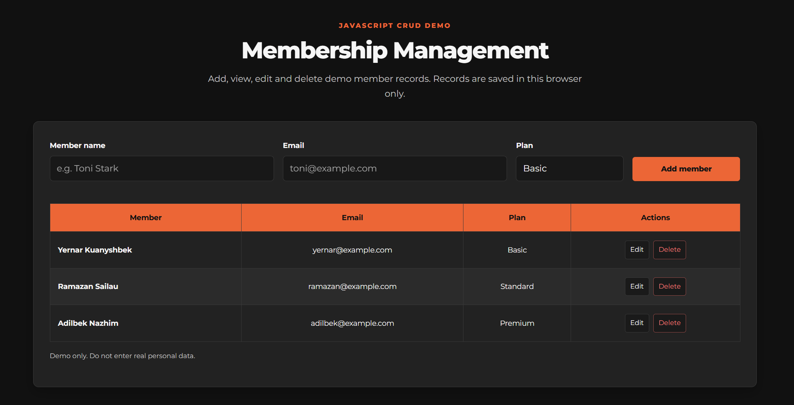
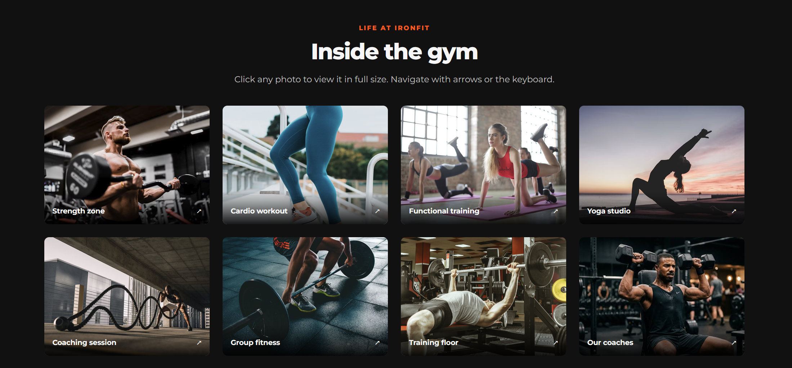

### Final — New Required Features

For the Final, we extended the Endterm project with:

1. **Sign In / Sign Out:** a new **signin.html** page; email/password input validation; a demo signed-in state stored in **localStorage**; persistence after refresh; a changed navigation interface; and Logout.
2. **jQuery FAQ:** six gym-related questions on the Home page; answers open and close using the required **.slideToggle()** method; the **+ / −** indicator changes with the answer state.
3. **Public Fitness API:** the Programs page loads exercise information from the **wger API** using **fetch()**, processes JSON, displays cards dynamically, supports search/category filtering and Refresh, and shows a useful error message if loading fails.
4. **Project-wide integration:** seven connected pages, consistent styles, and an AI-use acknowledgement on the website.

**Important:** The Sign In feature is a **frontend demonstration**, not secure server authentication. It saves non-sensitive information (email / login state) locally; it does **not** store passwords or check accounts against a database.

## 3. Website Pages

### 1. Home — index.html

Introduces the gym, shows its advantages, and contains the Final FAQ section. The theme toggle is available from the shared navigation.

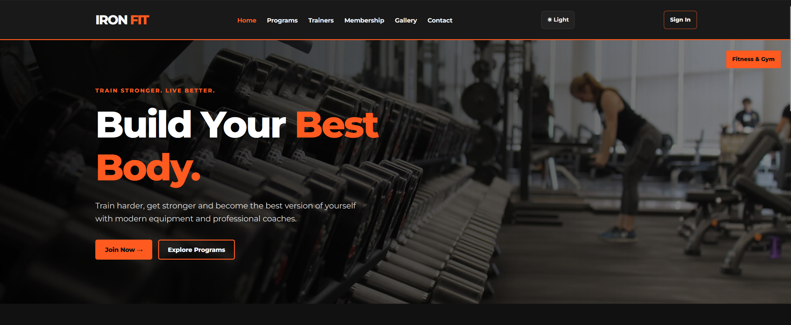
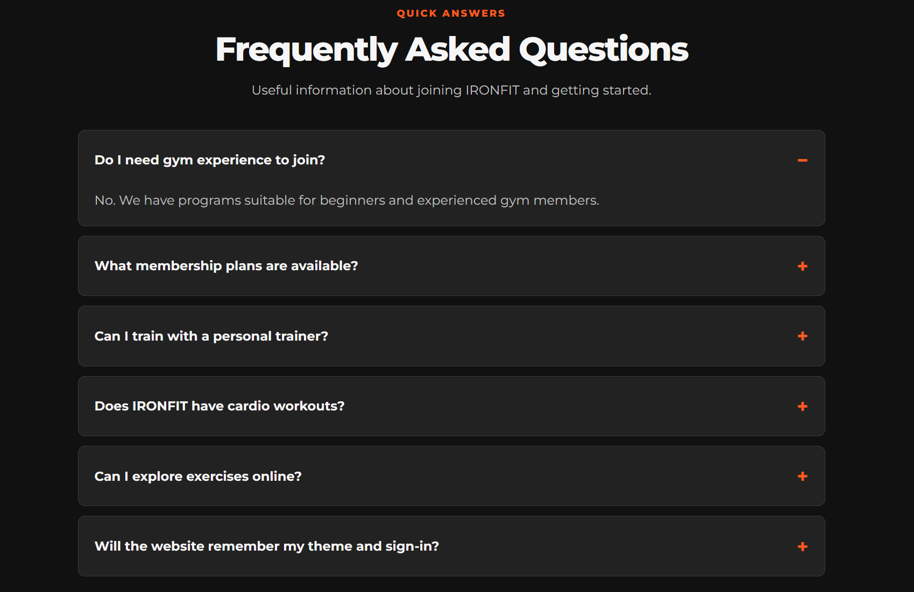

### 2. Programs — programs.html

Contains our original gym programs and Endterm search/filter controls. The Final section **Explore Real Exercises** loads exercise data from the public API.

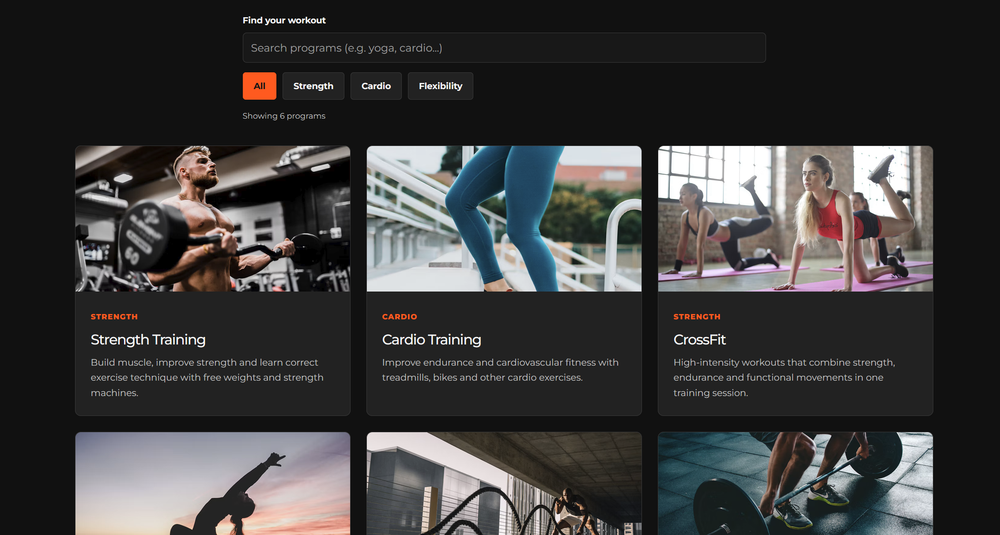
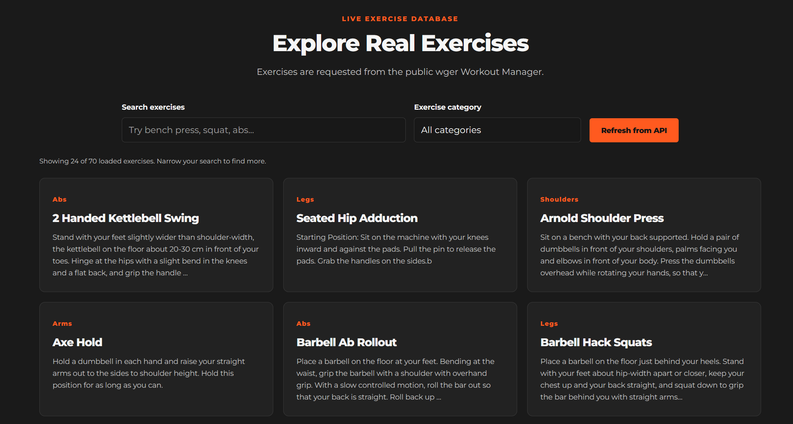

### 3. Trainers — trainers.html

Presents trainers, specializations, and experience in a responsive card layout.

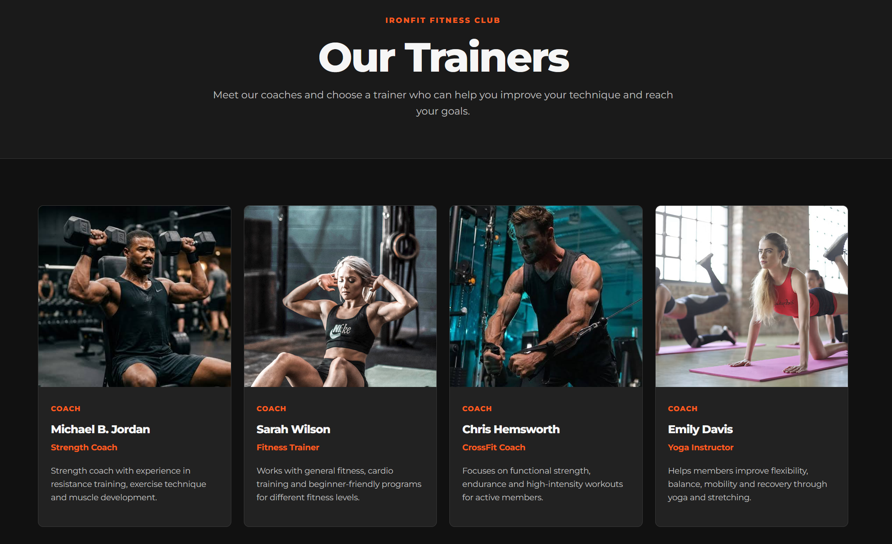

### 4. Membership — membership.html

Displays gym membership plans, a comparison table, and the Endterm membership CRUD functionality.

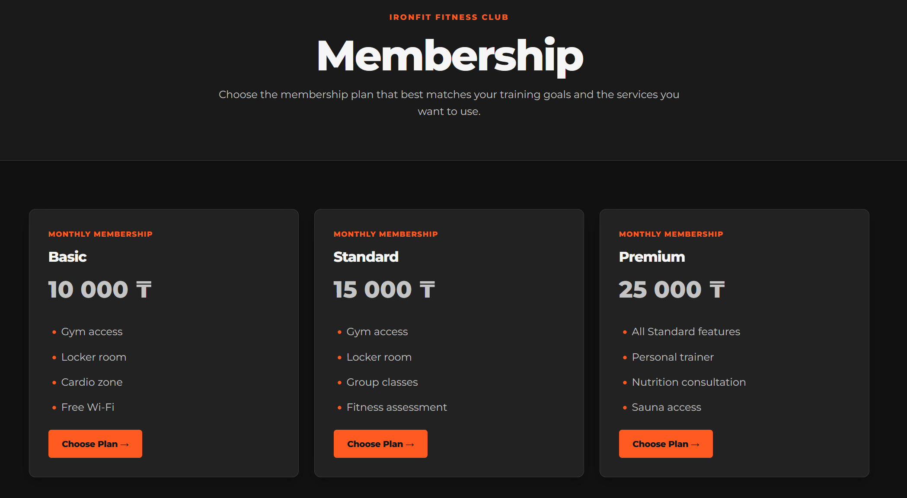

### 5. Contact — contact.html

Contains contact information and the Endterm form-validation features: required fields, RegEx email checks, password-strength feedback, and confirmation checking.

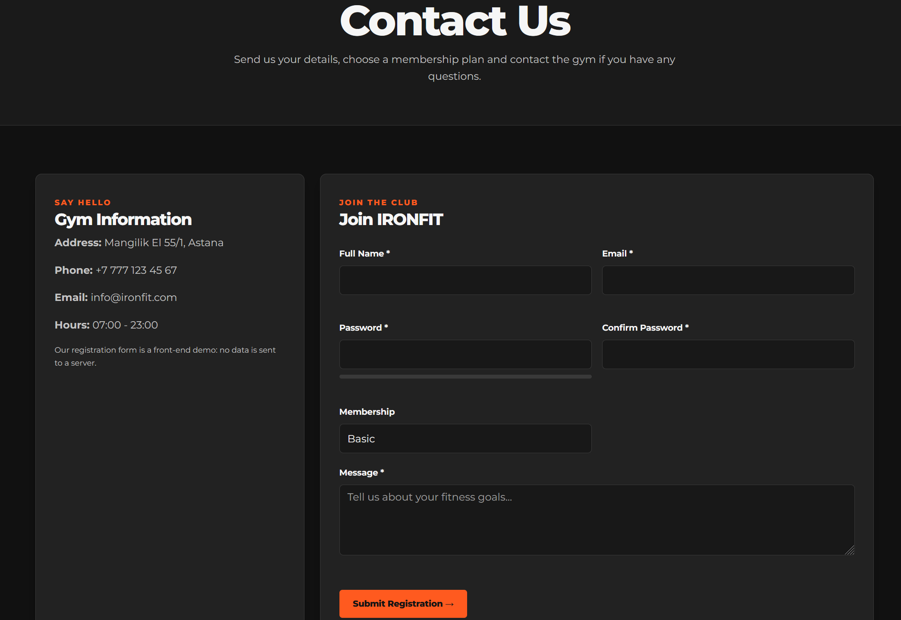

### 6. Gallery — gallery.html

Shows fitness photos in a responsive image grid and supports the Endterm lightbox, Previous/Next navigation, keyboard controls, and jQuery animations.

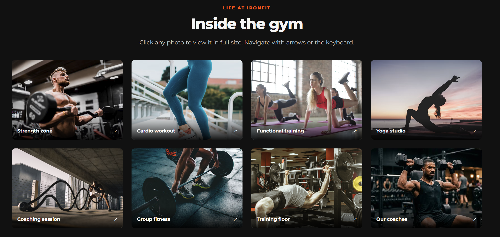

### 7. Sign In — signin.html

Introduced for the Final. Validates user input and saves the demo login state in localStorage. After signing in, the website displays the signed-in interface and Logout. The state remains after refreshing the browser.

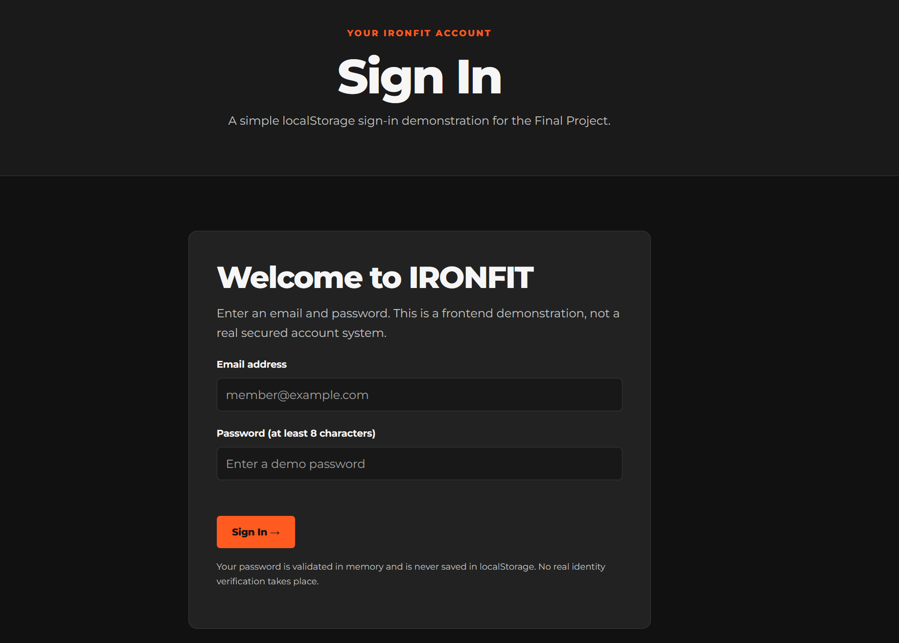

## 4. Technologies and Project Structure

**Technologies:** HTML5, CSS3, Bootstrap 5, JavaScript (ES6), jQuery, DOM manipulation, RegEx, localStorage, fetch(), JSON, Flexbox, CSS Grid, media queries, and Google Fonts.

**Public API:** [wger Workout Manager](https://wger.de/) (`https://wger.de/api/v2/exerciseinfo/?format=json&limit=70`). The API results require an internet connection, and availability should be checked on the published site.

## 5. Individual Contributions and Final Task Distribution

The **Midterm and Endterm contributions below are preserved from the original README**. The **Final assignments are a proposed division of responsibilities**, not a claim about who personally wrote the current code. Confirm and update this section to match the group's **actual Final work** before submitting the report.

### Student 1 — Yernar Kuanyshbek

**Midterm:** Developed the Home page, header, navigation bar, footer, and general website styling.

**Endterm:** Implemented Light/Dark Mode, saved the selected theme using localStorage, integrated JavaScript functionality, updated navigation, and improved responsive design.

**Final:**
- Implemented **Sign In / Sign Out** functionality with input validation.
- Added localStorage to keep users signed in after refreshing the page.
- Updated the navigation bar and user interface across all seven pages.
- Checked HTML/CSS responsiveness, navigation links, and overall design consistency.

### Student 2 — Ramazan Sailau

**Midterm:** Developed the Programs and Trainers pages, designed program cards, and added hover effects.

**Endterm:** Implemented dynamic program search, category filtering, jQuery event handling, and the Gallery page with lightbox functionality and image navigation.

**Final:**
- Integrated the **public Fitness API** into the Programs page using fetch() and JSON.
- Implemented dynamic exercise cards using data retrieved from the API.
- Added API search, category filtering, Refresh functionality, and error handling.
- Improved the Programs page and checked its existing search and filtering features.
- Reviewed the Gallery functionality, including image navigation and lightbox interactions.

### Student 3 — Adilbek Nazhim

**Midterm:** Developed the Membership and Contact pages, including the membership table and contact form.

**Endterm:** Implemented JavaScript form validation, email RegEx, password-strength feedback, password confirmation, membership CRUD operations, and localStorage.

**Final:**
- Developed the **jQuery FAQ** section with six questions related to the fitness website.
- Implemented .slideToggle() animations to show and hide answers.
- Added +/− indicators to display the current state of each FAQ question.
- Checked Contact form validation and Membership CRUD functionality.
- Prepared the **Final Project Report**, including project descriptions, individual contributions, and screenshot sections.

## 7. GitHub Links and Submission

- **GitHub repository:** https://github.com/yernar122/endterm_fitness_website
- **GitHub Pages (live website):** https://yernar122.github.io/endterm_fitness_website/

## 8. AI Usage Acknowledgement

**ChatGPT (OpenAI)** ChatGPT was used to help organize the project workflow, divide responsibilities among team members, and improve the structure of the project documentation.

## 9. Conclusion

IRONFIT grew from a responsive five-page Midterm website into an interactive six-page Endterm project and a seven-page Final project. The development stages helped us practice HTML/CSS layout, DOM interactions, form validation, jQuery animations, browser storage, and live API integration. Our final goal is a consistent, responsive fitness website whose features can be clearly demonstrated and explained during the defense.
